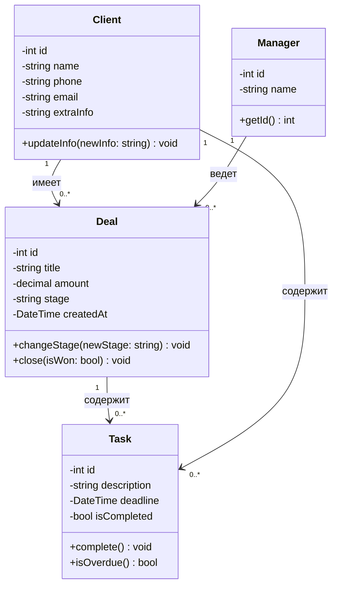
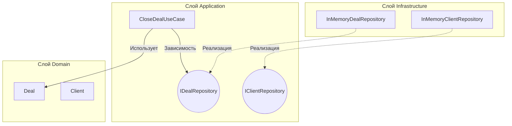
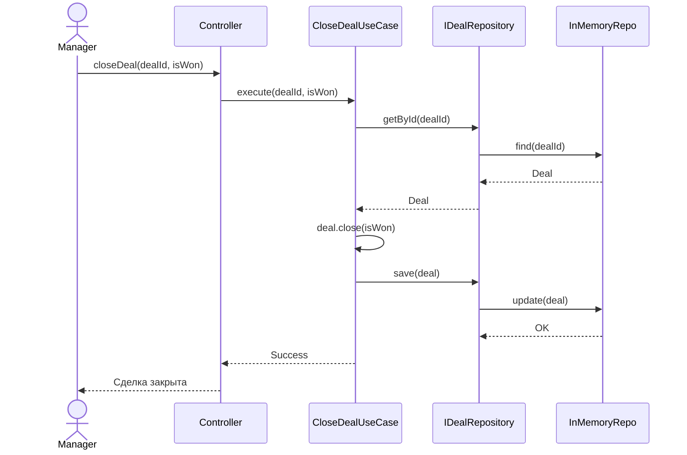

# Лабораторная работа №5. CRM-система
**Вариант:** 16  
**Тема:** Проектирование CRM-системы с использованием паттерна Clean Architecture  
**Выполнил:** Марков Даниил Викторович

---

## 1. Описание предметной области и задачи

CRM-система (Customer Relationship Management) — это программа, которая помогает компании работать с клиентами и не терять деньги. В обычной жизни менеджеры записывают клиентов в блокноты, забывают перезвонить или путают этапы сделок. Наша система автоматизирует этот процесс.

**Какие задачи решает система (по заданию):**
* Ведение базы клиентов (сохранение ФИО/организации, телефона, почты и заметок).
* Создание и сопровождение сделок (фиксация суммы, ответственного менеджера и текущего этапа).
* Управление этапами сделки (от «Новой» до «Успешно завершенной» или «Проигранной»).
* Постановка задач, привязанных к клиентам или сделкам, с указанием дедлайна.

**Основные сущности:**
* **Client (Клиент)** — хранит контактные данные.
* **Manager (Менеджер)** — сотрудник, который ведет сделку.
* **Deal (Сделка)** — процесс продажи (название, сумма, этап, дата).
* **Task (Задача)** — поручение для менеджера (например, «Позвонить клиенту»).

---

## 2. Архитектура приложения

Проект написан с использованием паттерна **Clean Architecture**. Это разделение кода на слои, чтобы бизнес-логика не зависела от базы данных или интерфейса. Если завтра мы решим сменить базу данных, нам не придется переписывать половину проекта.

**Подробно о каждом слое:**

1. **Domain (Слой сущностей):** 
   Это самое сердце программы. Здесь находятся наши классы (`Client`, `Manager`, `Deal`, `Task`). В них описаны только данные (поля) и базовые действия (например, изменить статус задачи). Этот слой вообще ничего не знает о базах данных или веб-сайтах. Он полностью изолирован.

2. **Application (Слой бизнес-логики):**
   Здесь описаны сценарии использования (Use Cases). Например, сценарий «Закрыть сделку». Также на этом слое мы создаем **интерфейсы репозиториев** (например, `IDealRepository`). Это такие «контракты», которые говорят: «Любая база данных обязана уметь сохранять сделку и находить её по ID». Благодаря этому слой логики не привязан к конкретной базе.

3. **Infrastructure (Слой инфраструктуры):**
   Здесь находится конкретный код работы с данными. В нашем случае это `InMemoryDealRepository` (хранение данных в оперативной памяти). Этот слой зависит от бизнес-логики (реализует её интерфейсы), а не наоборот. Именно поэтому зависимости в архитектуре направлены «внутрь» — к центру.

---

## 3. UML-диаграммы

Ниже представлены три диаграммы, которые показывают, как устроена система с разных сторон.

### 3.1. Диаграмма классов (Class Diagram)
Эта диаграмма показывает «скелет» программы. Мы видим наши сущности, их поля (они скрыты, так как стоят минусы `-` — это инкапсуляция) и публичные методы (плюсы `+`), через которые мы управляем объектами. Также диаграмма показывает связи: у одного клиента может быть много сделок, а у сделки — много задач.

### 3.2. Диаграмма компонентов (Component Diagram)
Здесь подробно расписано, как слои общаются друг с другом. Главная фишка — пунктирные стрелочки от слоя `Infrastructure` к слою `Application`. Это значит, что база данных «подчиняется» нашим правилам (реализует интерфейсы). Слой `Domain` вообще стоит в стороне, потому что он ни от кого не зависит.

### 3.3. Диаграмма последовательности (Sequence Diagram)
Эта диаграмма показывает, что происходит по шагам, когда менеджер закрывает сделку. Сначала запрос идет от менеджера к контроллеру, затем в сценарий (`UseCase`). Сценарий запрашивает сделку из базы, вызывает у неё метод закрытия, и просит базу сохранить изменения.

---

## 4. Описание алгоритмов

В системе реализованы конкретные алгоритмы, которые выполняются по определенным правилам.

**4.1. Как система определяет просроченные задачи?**
* В классе `Task` есть метод `isOverdue()`. 
* Алгоритм проверяет два условия одновременно: 
  1. Дедлайн задачи (`deadline`) меньше текущей даты. 
  2. Задача еще не выполнена (`isCompleted == false`).
* Если оба условия совпали — задача считается просроченной. Сценарий просто запрашивает список таких задач, чтобы показать их менеджеру.

**4.2. Как происходит смена этапа сделки?**
* Сделка имеет строгий жизненный цикл: от «Новой» до «Успешно завершена» или «Проиграна».
* Когда вызывается метод `changeStage()`, система проверяет: а не закрыта ли сделка уже?
* Если сделка находится в финальном статусе, программа выдаст ошибку и не даст изменить этап. Это защищает историю продаж от случайных правок.

**4.3. Как работает закрытие сделки?**
* Вызывается метод `close(isWon: bool)`.
* Если менеджер передает `true`, этап сделки автоматически меняется на «Успешно завершена». 
* Если передается `false` — на «Проиграна».

---

## 5. Бизнес-правила системы

Бизнес-правила — это ограничения, которые соблюдает наша программа, чтобы работать корректно и защищать данные.

1. **Правило валидации клиента:** При создании нового клиента поле `name` (ФИО или название организации) не может быть пустым. Если оно пустое, система выбросит исключение и не сохранит клиента.
2. **Правило закрытых сделок:** Если сделка уже закрыта (успешно или проиграна), менять её этап через обычный метод смены этапа запрещено. Для этого нужно создавать новую сделку. Это защищает историю.
3. **Правило просроченных задач:** Задача может быть просроченной только в том случае, если она не выполнена. Если менеджер нажал «Выполнить», задача автоматически перестает считаться просроченной, даже если дедлайн прошел.
4. **Правило привязки задач:** Задача обязательно должна быть привязана либо к конкретной сделке, либо к клиенту. «Беспризорных» задач в системе быть не может.

---